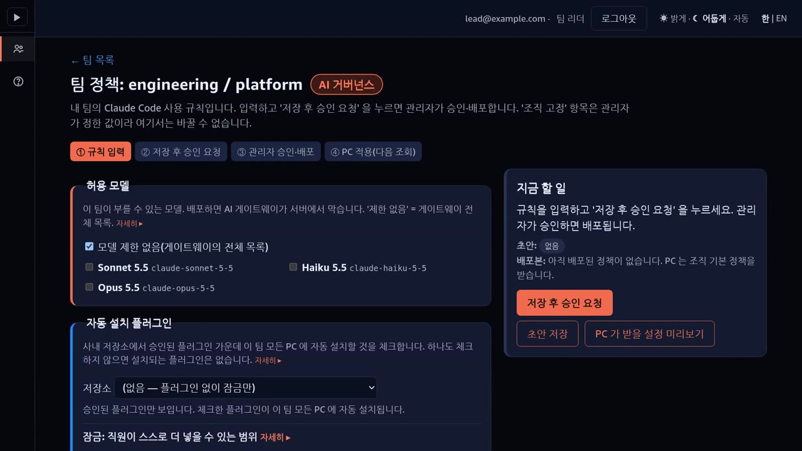

# AI Governance Hub

팀별 Claude Code 정책(허용 모델 · 플러그인 · MCP 서버 · 사내 에이전트 · 잠금)을 **허브가 정하고,
직원 PC 와 AI 게이트웨이가 막는** 시제품입니다.



▶ 시연 영상 [한국어 4분 44초](https://youtu.be/r8HvLV4a3X0) · [English 4:40](https://youtu.be/0MIDHtEEc7s) ·
설명 자료 [웹 덱](https://d18xts7dcimr4w.cloudfront.net/) <!-- # mask-ok -->

## 무엇을 하나

- **팀 리더**가 팀 정책을 만들어 승인을 요청하고, **관리자**가 변경 사항을 보고 승인·배포합니다.
- 배포된 정책은 직원 PC 의 Claude Code 가 다음에 물을 때(시작할 때와 5분마다) 적용됩니다.
- 허용 모델은 AI 게이트웨이가 서버에서도 막습니다. 사내 에이전트는 도구 게이트웨이를 거쳐서만 호출됩니다.
- 누가 무엇을 언제 바꿨는지 활동 기록에 남습니다.

```text
┌─ Governance Hub ───────┐         ┌─ LLM gateway ──────────┐         ┌─ Employee PC ──────────┐
│ this repository        │         │ GET /v1/policy         │         │ Claude Code            │
│ team policy, approval  │◀─(2)────┤ models: its own DB     │◀─(1)────┤ policy-helper          │
│ activity log           │         │ other keys: ask hub    │         │ baseline + fragment    │
│ agent approval         │         │ enforces models        │         │ = managed settings     │
└────────────┬───────────┘         └────────────┬───────────┘         └────────────┬───────────┘
             │ (3)                              │ (4)                              │ (5)
             │                                  │                                  │
             │                                  │                                  │
             ▼                                  ▼                                  ▼
┌─ gateway admin-api ────┐         ┌─ Amazon Bedrock ───────┐         ┌─ AgentCore Gateway ────┐
│ team allowed models    │         │ inference              │         │ MCP, Cognito login     │
│ users, teams, VK       │         │                        │         │ -> Runtime (agents)    │
└────────────────────────┘         └────────────────────────┘         └────────────────────────┘

  (1) PC 의 policy-helper 가 시작할 때와 5분마다 VK 로 정책을 묻습니다.
  (2) 게이트웨이가 그 사용자의 팀을 허브에 넘겨(POST /v1/resolve)
      플러그인·MCP·잠금 조각을 받습니다.
  (3) 허브는 정책을 배포할 때 팀 허용 모델을 게이트웨이 admin-api 에 써 넣습니다.
  (4) 추론. 허용 밖 모델은 게이트웨이가 거부합니다.
  (5) 사내 에이전트·MCP 서버는 도구 게이트웨이(AgentCore Gateway)를 거쳐서만 호출됩니다.
      허브가 승인된 에이전트를 이 게이트웨이의 대상으로 등록합니다.
```

## 구성

폴더와 파일 안내 → [docs/structure.md](docs/structure.md)

## 실제로 배포하려면

허브만으로는 동작하지 않습니다. 게이트웨이가 먼저입니다.

1. 게이트웨이 설치 — [AWSome AI Gateway — 해외 배포판](https://github.com/gonsoomoon-ml/sample-agentic-ai-acceleration-kr/tree/us/deploy-fixes/projects/awsome-ai-gateway/docs/us-llm-gateway) (EKS·Aurora·Cognito, 큰 작업)
2. `US-21` 적용 — [8-G](https://github.com/gonsoomoon-ml/sample-agentic-ai-acceleration-kr/blob/us/deploy-fixes/projects/awsome-ai-gateway/docs/us-llm-gateway/ops/8-G-policy-helper.md) (원본 aws-samples 게이트웨이에는 없는 기능)
3. 허브 설치 — 아래 순서
4. 직원 PC 에 policy-helper 설치 — 8-G 의 21-A

**허브 설치 순서** (각 스크립트 머리말에 쓰는 법이 있습니다)

1. `deploy/hub/env.example` 을 `deploy/hub/.env` 로 복사해 채웁니다.
2. `10-table-and-role.py ensure` — DynamoDB 표와 IAM 역할
3. `20-cognito-callback.sh` — 허브 로그인 콜백 등록
4. `30-service-token.sh` — 게이트웨이 admin-api 서비스 토큰
5. 이미지 빌드(`Dockerfile`) 후 ECR 에 올림
6. `40-values.sh` — values 생성 → `helm upgrade --install`
7. `50-gateway-values.sh` — 게이트웨이가 허브를 부르도록 값 두 개 → 게이트웨이 재배포
8. (선택) 사내 에이전트: `agents/common/deploy_runtime.py` → `deploy/agentcore/` 의 10 → 20 → 30 → 40

## Hub 와 게이트웨이가 주고받는 것

- 게이트웨이 → 허브: `POST /v1/resolve` `{user_id, team_id, client}` → `{version, managedSettings}`.
고정 토큰으로 인증합니다.
- 허브가 줄 수 있는 키는 8개입니다: `strictKnownMarketplaces` · `extraKnownMarketplaces` ·
`enabledPlugins` · `disableSideloadFlags` · `strictPluginOnlyCustomization` · `managedMcpServers` ·
`allowManagedMcpServersOnly` · `permissions`(deny 만). 그 밖의 키는 게이트웨이가 버립니다.
- 모델 키는 허브가 주지 않습니다. 허브는 배포할 때 게이트웨이 admin-api 에 팀 허용 모델을 써 넣고,
PC 로 가는 모델 목록은 게이트웨이가 같은 표에서 계산합니다.
- 허브가 멈추면 게이트웨이는 503 을 주고 PC 는 마지막 정책을 유지합니다.

## 라이선스

[MIT-0](LICENSE)
